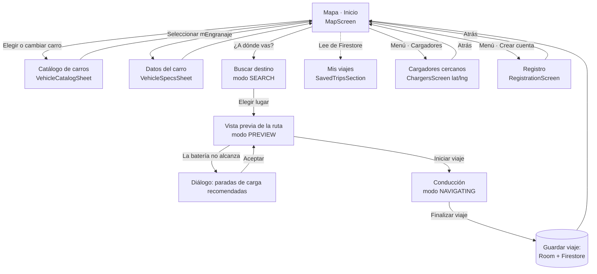
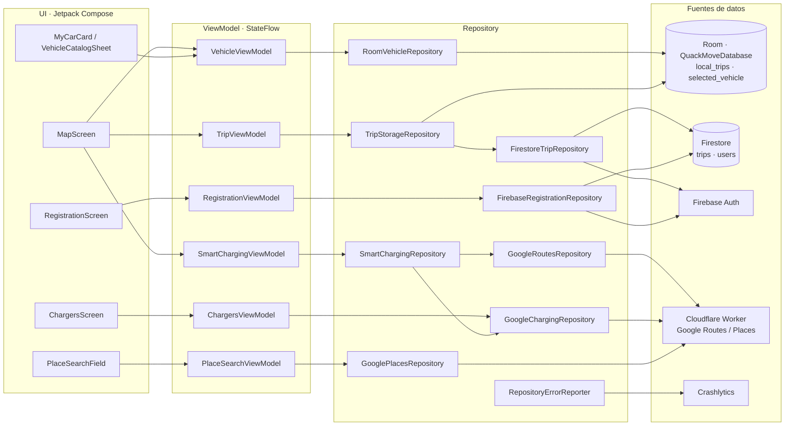

# QuackMove

App Android para planificar viajes en carro eléctrico en Guatemala: calcula si la batería alcanza para llegar al destino y, si no alcanza, propone paradas en cargadores cercanos a la ruta.

> **Versión:** 1.1 (versionCode 2) · **Rama de entrega:** `entrega-final`

> **Equipo:** Daniel Andrés Rivas Lucas (251478) · David Fernando González Canel (251429) · José David Soto Puac (25875) — CC3087, Sección 11, segundo ciclo 2026.

---

## 1. Problema y solución

**Usuario:** propietarios de carros 100 % eléctricos en Guatemala que se mueven a diario dentro de la ciudad y cargan en casa, pero que una o dos veces al mes viajan fuera de la ciudad (Antigua Guatemala, Escuintla, el Puerto de San José). Lo validamos en la Entrega 1 entrevistando a **Rosario Vásquez** (38 años, administradora, maneja un Volvo EX30) y a **Héctor** (19 años, estudiante de la UVG).

**Problema validado:** para viajar fuera de la ciudad tienen que buscar con anticipación dónde hay estaciones de carga y si están funcionando. Esa información está repartida en distintas apps, y planificar el recorrido les quita tiempo. Rosario lo resumió así:

> «Lo que más tiempo me tomó fue confirmar cuál estación podía usar. Algunas aparecían en el mapa, pero no siempre era claro si estaban funcionando o si estaban ocupadas.» — Rosario Vásquez

**Propuesta de valor:** en una sola app, QuackMove le dice al conductor antes de salir con cuánta batería llegará **según su modelo de carro**, y si no le alcanza, le propone paradas en cargadores sobre la ruta, mostrando cuáles aparecen disponibles.

---

## 2. Cómo ejecutar

| Requisito | Versión |
|---|---|
| Android Studio | 2026.1 (build AI-261) o superior, con AGP 9.3 |
| JDK | El que trae Android Studio (JBR) |
| minSdk / targetSdk | 26 (Android 8.0) / 37 |
| Gradle | 9.5 (se descarga solo con el wrapper) |

**Pasos:**

1. Clonar el repositorio:
   ```bash
   git clone https://github.com/space112921-cell/QuackMove-Entrega4-Final.git
   ```
2. Abrir Android Studio → **File → Open** → elegir la carpeta `QuackMove-Entrega4-Final`.
3. Esperar a que termine **Gradle Sync**. El archivo `app/google-services.json` ya está en el repositorio, así que Firebase queda configurado sin pasos extra.
4. Conectar un teléfono con Android 8.0 o superior (o crear un emulador) y presionar **Run ▶** sobre el módulo `app`.
5. Aceptar el permiso de ubicación para calcular rutas desde la posición actual. Si se rechaza, la app sigue funcionando y se puede elegir el origen a mano.

**Pruebas unitarias:**
```bash
./gradlew :app:testDebugUnitTest
```

> **Windows:** si la ruta del proyecto tiene tildes o "ñ" (por ejemplo `Programación`), Gradle se niega a compilar. Hay que mover el proyecto a una ruta sin tildes o compilar con `-Pandroid.overridePathCheck=true`.

---

## 3. Flujo de usuario



- Las pantallas se navegan con Navigation Compose en [`QuackMoveNavigation.kt`](app/src/main/java/com/quackmove/app/navigation/QuackMoveNavigation.kt). La pantalla de cargadores recibe la latitud y la longitud como argumentos.
- Los modos `HOME`, `SEARCH`, `PREVIEW` y `NAVIGATING` son estados del panel inferior de `MapScreen`, no pantallas separadas.

---

## 4. Arquitectura



- **Inyección:** los ViewModel reciben su Repository por constructor mediante una `Factory`. Los Repository se crean en [`QuackMoveDependencies`](app/src/main/java/com/quackmove/app/data/repository/QuackMoveDependencies.kt) o en `MainActivity`, nunca dentro del ViewModel.
- **Errores:** cada Repository envuelve sus operaciones con `withErrorReporting(...)`, que registra el error en Crashlytics como no fatal y lo vuelve a lanzar para que el ViewModel muestre el estado de error.
- **Claves de Google:** la app nunca guarda la API key. Llama al Worker de Cloudflare con el token de Firebase Auth, y el Worker es quien consulta a Google.

---

## 5. Mínimos técnicos

| ID | Dónde se cumple |
|---|---|
| **M1** Tema propio | [`Theme.kt`](app/src/main/java/com/quackmove/app/ui/theme/Theme.kt), [`Color.kt`](app/src/main/java/com/quackmove/app/ui/theme/Color.kt), [`Type.kt`](app/src/main/java/com/quackmove/app/ui/theme/Type.kt) |
| **M2** Navegación con argumento y Atrás | [`QuackMoveNavigation.kt` · ruta `cargadores/{latitude}/{longitude}`](app/src/main/java/com/quackmove/app/navigation/QuackMoveNavigation.kt#L22). Protección contra doble toque en Atrás en [`isResumed` / `popIfResumed`](app/src/main/java/com/quackmove/app/navigation/QuackMoveNavigation.kt#L144) |
| **M3** LazyColumn con `key` | [`MyCarCard.kt` · catálogo](app/src/main/java/com/quackmove/app/feature/vehicle/MyCarCard.kt#L407) (`key = { vehicle -> vehicle.id }`), [`PlaceSearchField.kt`](app/src/main/java/com/quackmove/app/feature/home/PlaceSearchField.kt#L166) |
| **M4** Formulario validado en tiempo real | [`RegistrationScreen.kt`](app/src/main/java/com/quackmove/app/feature/registration/RegistrationScreen.kt#L178) (`isError` y `supportingText` junto a cada campo; el botón solo se habilita con `state.validForm`), con reglas en [`RegistrationValidator`](app/src/main/java/com/quackmove/app/domain/RegistrationValidator.kt#L6) |
| **M5** ViewModel + StateFlow que sobrevive a la rotación | [`VehicleViewModel`](app/src/main/java/com/quackmove/app/feature/vehicle/VehicleViewModel.kt#L69), [`RegistrationViewModel`](app/src/main/java/com/quackmove/app/feature/registration/RegistrationViewModel.kt#L89), [`SmartChargingViewModel`](app/src/main/java/com/quackmove/app/feature/home/SmartChargingViewModel.kt#L33), [`ChargersViewModel`](app/src/main/java/com/quackmove/app/feature/chargers/ChargersViewModel.kt#L92), [`PlaceSearchViewModel`](app/src/main/java/com/quackmove/app/feature/home/PlaceSearchViewModel.kt#L37). Composables de contenido que reciben el estado y avisan con callbacks: `MyCarCard`, [`PlaceSearchFieldContent`](app/src/main/java/com/quackmove/app/feature/home/PlaceSearchField.kt#L77), [`SavedTripsSection`](app/src/main/java/com/quackmove/app/feature/home/SavedTripsSection.kt#L46) |
| **M6** Sin Firebase ni Room en Composables y ViewModels | Los Repository se crean en [`QuackMoveDependencies`](app/src/main/java/com/quackmove/app/data/repository/QuackMoveDependencies.kt#L18). Los errores de Firebase se traducen en [`FirebaseRegistrationRepository`](app/src/main/java/com/quackmove/app/data/repository/FirebaseRegistrationRepository.kt) |
| **M7** Repository por constructor | [`VehicleViewModelFactory`](app/src/main/java/com/quackmove/app/feature/vehicle/VehicleViewModel.kt#L250), [`RegistrationViewModelFactory`](app/src/main/java/com/quackmove/app/feature/registration/RegistrationViewModel.kt#L432), [`ChargersViewModelFactory`](app/src/main/java/com/quackmove/app/feature/chargers/ChargersViewModel.kt#L356) |
| **M8** `suspend` / `Flow` desde `viewModelScope` | [`VehicleViewModel.loadCatalog`](app/src/main/java/com/quackmove/app/feature/vehicle/VehicleViewModel.kt#L92); [`RoomVehicleRepository.observeSelection`](app/src/main/java/com/quackmove/app/data/repository/RoomVehicleRepository.kt) devuelve un `Flow` |
| **M9** Firestore | **Escritura:** al finalizar un viaje se guarda en la colección `trips` con [`FirestoreTripRepository.saveTrip`](app/src/main/java/com/quackmove/app/data/repository/FirestoreTripRepository.kt#L26). **Lectura:** [`getTrips`](app/src/main/java/com/quackmove/app/data/repository/FirestoreTripRepository.kt#L51) devuelve `List<SavedTrip>` (data class de dominio); [`TripViewModel.loadSavedTrips`](app/src/main/java/com/quackmove/app/data/TripViewModel.kt#L75) los carga y se muestran en la sección **Mis viajes** del inicio |
| **M10** Carga, error y vacío | Mis viajes (cargando, vacío, error con «Reintentar»): [`SavedTripsSection.kt`](app/src/main/java/com/quackmove/app/feature/home/SavedTripsSection.kt#L46). Catálogo: [`MyCarCard.kt`](app/src/main/java/com/quackmove/app/feature/vehicle/MyCarCard.kt#L378). Cargadores: [`ChargersScreen.kt`](app/src/main/java/com/quackmove/app/feature/chargers/ChargersScreen.kt#L311). Los tiempos de espera se convierten en error y no dejan la pantalla cargando: [`RepositoryErrorReporter.kt`](app/src/main/java/com/quackmove/app/data/repository/RepositoryErrorReporter.kt#L68) |
| **M11** Room | Entities [`LocalTripEntity`](app/src/main/java/com/quackmove/app/data/local/LocalTripEntity.kt#L8) y [`SelectedVehicleEntity`](app/src/main/java/com/quackmove/app/data/local/SelectedVehicleEntity.kt#L8), DAO [`SelectedVehicleDao`](app/src/main/java/com/quackmove/app/data/local/SelectedVehicleDao.kt#L9), base [`QuackMoveDatabase`](app/src/main/java/com/quackmove/app/data/local/QuackMoveDatabase.kt#L12). El carro elegido y su batería sobreviven a cerrar y reabrir la app |
| **M12** Convenciones del curso | Paquetes por función (`feature/`, `data/`, `domain/`, `navigation/`, `ui/`), identificadores en inglés y comentarios en español |
| **M13** Crashlytics no fatal | [`RepositoryErrorReporter.record`](app/src/main/java/com/quackmove/app/data/repository/RepositoryErrorReporter.kt#L44), usado por todos los Repository |
| **M14** App Distribution | Build 1.1 (versionCode 2) distribuido con notas de versión a testers externos al equipo; la captura de las descargas está en la descripción del PR |
| **M15** Sin bugs críticos | Corregidos los hallazgos críticos del cross-review (ver descripción del PR) |
| Permisos | Ubicación pedida en tiempo de ejecución; si se rechaza, se muestra un aviso y la app sigue funcionando: [`MainActivity.kt`](app/src/main/java/com/quackmove/app/MainActivity.kt#L263) |

---

## 6. Alcance

Las user stories salen de las personas de la Entrega 1 (Rosario y Héctor) y de las frustraciones que nos contaron.

| User story | Dentro / Fuera | ¿Se cumplió? |
|---|---|---|
| Como conductora que viaja fuera de la ciudad, quiero saber antes de salir si mi batería alcanza para llegar a mi destino, para no quedarme sin carga en el camino. | Dentro | ✅ La vista previa muestra tiempo, distancia, consumo y batería al llegar |
| Como conductor, quiero elegir mi modelo de carro de un catálogo, para que la estimación use la batería y el consumo reales de mi carro. | Dentro | ✅ Catálogo de 16 modelos; el elegido se guarda en Room |
| Como conductora, quiero que la app me proponga paradas de carga sobre la ruta cuando la batería no alcanza, para no tener que buscarlas en otras apps. | Dentro | ✅ Diálogo «Paradas de carga recomendadas» |
| Como conductor, quiero ver los cargadores cercanos y si aparecen disponibles u ocupados, para elegir uno que sí pueda usar. | Dentro | ✅ Pantalla de cargadores con filtro «Disponibles» |
| Como conductor, quiero ver mis viajes anteriores, para repetir un recorrido sin planificarlo de nuevo. | Dentro | ✅ «Recientes» y «Mis viajes» (leídos de Firestore) |
| Como usuario, quiero crear una cuenta, para conservar mis viajes. | Dentro | ✅ Registro con Firebase Auth; los viajes anónimos se conservan al crear la cuenta |
| Como usuario, quiero iniciar sesión en otro teléfono con mi cuenta. | Fuera | — |
| Como conductor, quiero navegación paso a paso con voz durante el viaje. | Fuera | — |
| Como conductora, quiero reservar o pagar una estación de carga desde la app. | Fuera | — |
| Como conductor, quiero reportar que un cargador está fuera de servicio para avisar a otros usuarios. | Fuera | — |

**Limitaciones conocidas:**
- La pantalla de rutas (`RoutesScreen`, con el historial de viajes guardados) existe en el código, pero hoy no hay un botón que la abra.
- Las imágenes de los modelos del catálogo todavía no están: se muestra un ícono.

---

## 7. Referencias y uso de IA

**Documentación consultada:**
- [Jetpack Compose](https://developer.android.com/develop/ui/compose) y [Navigation Compose](https://developer.android.com/develop/ui/compose/navigation)
- [Arquitectura de apps: ViewModel, StateFlow y capa de datos](https://developer.android.com/topic/architecture)
- [Room](https://developer.android.com/training/data-storage/room) y [migraciones de Room](https://developer.android.com/training/data-storage/room/migrating-db-versions)
- [Cloud Firestore para Android](https://firebase.google.com/docs/firestore/quickstart) y [reglas de seguridad](https://firebase.google.com/docs/firestore/security/get-started)
- [Firebase Authentication](https://firebase.google.com/docs/auth/android/start)
- [Crashlytics: excepciones no fatales](https://firebase.google.com/docs/crashlytics/android/customize-crash-reports#log-excepts)
- [Firebase App Distribution](https://firebase.google.com/docs/app-distribution/android/distribute-console)
- [MapLibre Native para Android](https://maplibre.org/maplibre-native/android/api/) y [OpenFreeMap](https://openfreemap.org/)
- Material del curso: guías de las Entregas 1 a 4 y de la Entrega final.

**Declaración de uso de IA:**

| Herramienta | Para qué se usó | Partes asistidas | Cómo se verificó |
|---|---|---|---|
| Claude (Anthropic), en Claude Code | Revisión final contra la rúbrica y el cross-review; corrección de errores; implementación del catálogo de carros | Navegación protegida contra doble toque (`QuackMoveNavigation.kt`), búsqueda de destinos con ViewModel (`PlaceSearchViewModel`), lectura de viajes de Firestore en «Mis viajes» (`SavedTripsSection`, `TripViewModel.loadSavedTrips`), mapa de vista previa con MapLibre (`RouteMapPreview.kt`), separación de Firebase en Registro (M6), `RepositoryErrorReporter` (M13), catálogo de carros (`feature/vehicle/`, `RoomVehicleRepository`, `VehicleCatalog`, migración de Room v2) | Compilación y pruebas unitarias (`BatteryEstimatorTest`, `VehicleCatalogTest`); pruebas manuales en un Samsung A56: elegir y guardar carro, cerrar y reabrir la app, rotación de pantalla, doble toque en Atrás, búsqueda de destino y un viaje completo a Antigua Guatemala que se guardó en Room y Firestore y apareció en «Mis viajes». El equipo revisó el código para poder explicarlo en la defensa |
